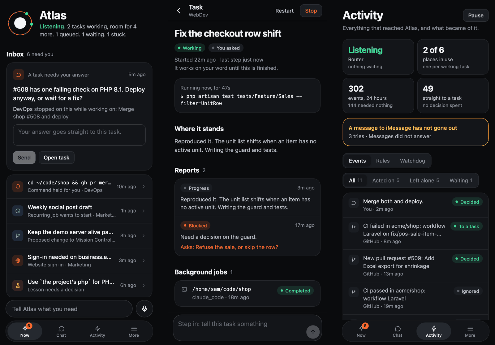

# Mission Control Mobile

The phone app for [Mission Control](https://github.com/hicka/missioncontrol): one
agent in your pocket, and what it is really doing in plain sight.



- **Now** shows whether the agent is listening, what needs you (held commands in
  full, questions, jobs asking to start, proposed changes, lessons), and what each
  task is doing, from the server's own record rather than anything the agent said.
- **A task** opens to its reports and every step. Step in, stop it or restart it from there.
- **Chat** is the one conversation, typed or spoken.
- **Activity** is everything that reached the agent and what became of it, the rules
  it decides by, and the Watchdog.
- **More** has recent tasks, the schedule, knowledge, what it has learned, its
  profiles with their direct lines, and every setting.

It needs a Mission Control server, and holds nothing of its own beyond the address
and token. Light and dark follow the phone, or pick one under More > Appearance.
Screenshots use sample data.

## Connect securely

1. On the machine running Mission Control, open Settings >
   Integrations > Mobile access: turn it on and copy the access token.
   Restart Mission Control once.
2. Put both devices on the same private network. The recommended way,
   which also works from anywhere, is [Tailscale](https://tailscale.com)
   on both the server machine and your phone.
3. In this app, enter the server address, e.g.
   `http://your-machine.tailnet.ts.net:8899`, paste the token, Connect.

Security model: the server trusts local requests only; every remote
request (including this app's) must carry the bearer token, which is
checked with a constant-time compare. The token is stored on the phone
in the system keychain via expo-secure-store. Do not expose the server
port to the open internet; keep it on a LAN or a VPN like Tailscale.

The app allows plain HTTP, because a server on your own network rarely has a
certificate. That is another reason to keep it on a LAN or a VPN. For what agents can
do on your machine, see the server's
[SECURITY.md](https://github.com/hicka/missioncontrol/blob/master/SECURITY.md).

If a Tailscale name will not connect from the phone, use the machine's Tailscale IP
address instead. A name with Funnel turned on resolves to public relays.

## Build your own

There is no public build, so you build and sign your own. You need Node 20 or newer
and an [Expo](https://expo.dev) account, plus an Apple Developer account for iOS.

The identifiers in the repo belong to the maintainer's builds, so change these first:

| File | Change |
| --- | --- |
| `app.json` | `expo.ios.bundleIdentifier`, `expo.android.package` and `expo.owner` |
| `app.json` | Remove `expo.extra.eas.projectId`, then run `eas init` for your own |
| `eas.json` | `submit.production.ios.ascAppId`, your app in App Store Connect |

```bash
npm install
eas build --platform ios --profile production
```

Add `--auto-submit` to send the build to TestFlight.

## Develop

```bash
npm install
npx expo start
```

Build a dev client (`npx expo run:ios`) or install a build from EAS: voice and push
need native modules that Expo Go does not carry. The app is plain React Native with no
navigation library: four tabs, and screens pushed over them, switched in `App.js`. Two
small config plugins keep this React Native 0.76 app building and launching with
current Xcode: `plugins/withFmtCxx17.js` (the bundled fmt library no longer compiles as
C++20) and `plugins/withSceneLifecycle.js` (iOS 27 launches apps built with its SDK only
if they adopt scenes).

## Layout

| Path | What it holds |
| --- | --- |
| `App.js` | Tabs, the screen stack, theme and the stored connection |
| `src/api.js` | The Mission Control client (URL and bearer token) |
| `src/harness.js` | What a task's state may honestly claim. Read this before changing a label |
| `src/store.js` | One shared picture of the server, kept current by live events |
| `src/theme.js`, `src/ui.js` | Design tokens and building blocks |
| `src/screens/` | Now, Chat, Task, Activity, More and the rest, with `config/` for settings |
| `src/components/` | The agent's mark, tasks, decisions and messages |

## Status and contributing

This is young software, built for one person's daily use. It is used on iOS. The Android
settings are there, but it has not been tested on Android. There are no automated tests
yet, so describe how you checked a change. Issues and pull requests are welcome.

Please report security problems privately, as the server's
[SECURITY.md](https://github.com/hicka/missioncontrol/blob/master/SECURITY.md) describes.

## License

[MIT](LICENSE)
